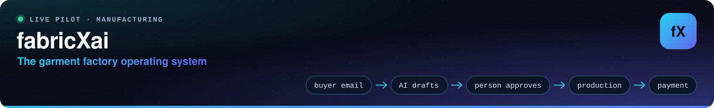
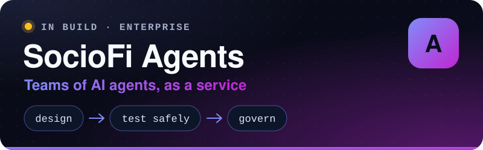
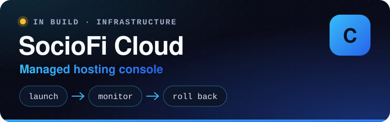
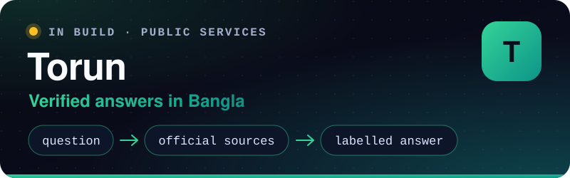
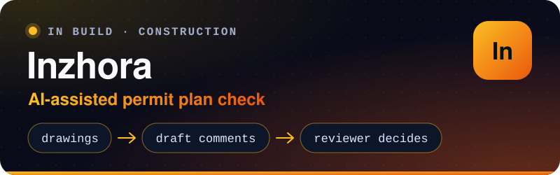
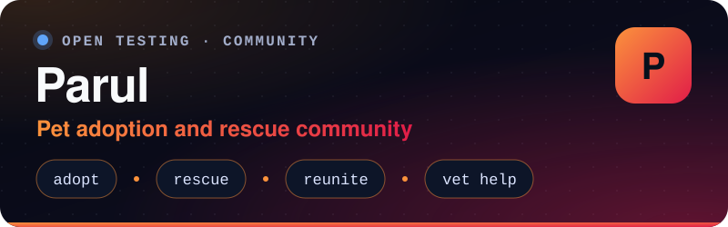
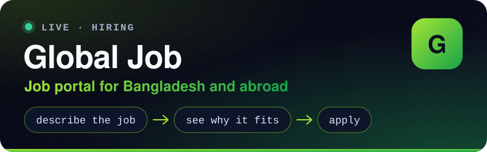
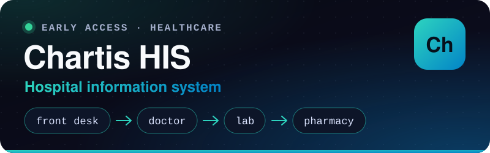

  

  
  
  
  

## About

I build **AI agent systems for real industries** — an AI-powered ERP for garment manufacturing, an agents-as-a-service platform underneath it, and a growing line of products where AI drafts and a person decides: verified answers in Bangla, building-permit plan review, hospital records, hiring.

My rule for production AI: **the model proposes, the system disposes.** The AI in my products never changes live data on its own. It drafts into an approval queue, it can only see what the signed-in user is allowed to see, it works inside hard limits on steps and cost, and anything that must be exact (prices, pass/fail results) is calculated by fixed rules, not by the model. That's the difference between a demo and something a factory can run its orders on.

The runway behind it: an EE degree (BUET), an M.S. thesis on self-supervised medical imaging, 9 deep-learning specializations — and a **GPT-2 trained from scratch in 2020**, back when language models were a niche hobby.

## What I've built

Nine products across manufacturing, public services, construction, healthcare, hiring and community. The same rule runs through all of them: **AI prepares the work, and a person makes the decision.**

<table>
  <tr>
    <td colspan="2" valign="top">
      
      
Garment factories and buying houses still run their orders through email, Excel and WhatsApp, retyping the same details at every step. fabricXai brings quoting, production, quality and compliance into one system and follows each order from the buyer's first email to the bank payment.

      
<b>AI's role:</b> It reads incoming documents, drafts the entries and works as an assistant inside every module. Each draft waits in a queue for a named person to approve it, so nothing is sent or changed on the AI's word alone. Prices are worked out by fixed formulas, never by the AI.

      
<a href="https://fabricxai.com">fabricxai.com</a>

    </td>
  </tr>
  <tr>
    <td width="50%" valign="top">
      
      
The platform underneath my other products. A company lays out a team of AI agents on a visual canvas, tries it in a safe test area with spending limits, and then puts it to work.

      
<b>AI's role:</b> Agents do the work inside fixed limits on steps, cost and time. A rule book sorts every action into allow, block or ask a person, and whenever something goes wrong the default is to ask a person. Every action is recorded.

    </td>
    <td width="50%" valign="top">
      
      
Hosting for teams that don't want to run their own servers. One console to launch an app, watch its health, and step back to the previous version if a release goes wrong.

      
<b>AI's role:</b> Deliberately small. AI writes a plain-language summary when something breaks and does nothing else. People make every change, and each one is kept in a record that cannot be edited.

    </td>
  </tr>
  <tr>
    <td width="50%" valign="top">
      
      
A Bangla-first assistant for everyday questions about public services in Bangladesh, such as national ID services. Answers are free, show their sources, and carry a label saying how far they can be trusted.

      
<b>AI's role:</b> It writes answers only from official sources that have been collected and checked. Any sentence it cannot tie to a source is removed, and when no source exists it says so instead of guessing. Editors review the sources and audit a sample of answers every month.

    </td>
    <td width="50%" valign="top">
      
      
Before a home can be built in California, a plan checker reads the drawings and lists everything that breaks the building code. Inzhora reads the submitted drawings and prepares that list as a first draft, in a markup screen that works the way reviewers already do.

      
<b>AI's role:</b> It drafts each comment with the code section it relies on and the spot on the drawing it refers to, and it is not allowed to invent a citation. A licensed reviewer accepts, edits or rejects every comment, and only accepted ones go into the letter to the applicant.

    </td>
  </tr>
  <tr>
    <td width="50%" valign="top">
      
      
Helps a brand decide what to say and when. It moves from market research to a strategy, then to a content calendar with drafts, and on to monitoring, in Bangla and English.

      
<b>AI's role:</b> It researches the market with sources attached and drafts the content. It is barred from making up prices, statistics or testimonials. The owner approves the strategy and every draft, and nothing is ever posted automatically.

      
<a href="https://signal.antarious.com">signal.antarious.com</a>

    </td>
    <td width="50%" valign="top">
      
      
A community app for pet owners, rescuers and vets: adoption, rescue alerts, lost-and-found, foster and transport help, blood donors, vet consults and messaging. In open testing on Google Play and on TestFlight for iPhone.

      
<b>AI in this product:</b> None, on purpose. This is a product about people helping animals, and it did not need AI to do that well.

      
<a href="https://parul.pet">parul.pet</a>

    </td>
  </tr>
  <tr>
    <td width="50%" valign="top">
      
      
A job site for work in Bangladesh and overseas. Instead of filling in filters, people describe the job they want in their own words and see, in plain language, why each opening suits them.

      
<b>AI's role:</b> It reads and understands what the job seeker writes. The matching itself follows fixed rules, and the AI never ranks people against each other.

      
<a href="https://jobglobal.sociofitechnology.com">jobglobal.sociofitechnology.com</a>

    </td>
    <td width="50%" valign="top">
      
      
A Bangla-first system for clinics, diagnostic centres and hospitals. Front desk, consultation, billing, lab, pharmacy and wards run in one place, with an owner's dashboard on top.

      
<b>AI's role:</b> It drafts the doctor's consultation note and marks it clearly as an unverified draft. The doctor reviews and signs every note, and the AI never makes a diagnosis.

      
<a href="https://chartis.sociofitechnology.com">chartis.sociofitechnology.com</a>

    </td>
  </tr>
</table>

## How I build

| Principle | What it means in practice |
| --- | --- |
| **AI proposes, a person approves** | AI output is a draft in a queue. It never changes live data on its own. |
| **Rules for anything that must be exact** | Prices, pass/fail results and calculations come from fixed logic, not from the AI. |
| **Every agent gets a budget** | Hard limits on steps, cost and time, so nothing runs away. |
| **Right-sized AI** | Small, cheap models for routine volume; the strongest ones only where real reasoning is needed. |
| **Privacy enforced by the system** | Each customer's data is fenced off underneath the AI, not by trusting an instruction. |

## Currently going deeper

- **Connecting AI to real systems safely** — giving models controlled, well-defined access to the tools a business already runs on
- **Small and local models** — moving more routine work onto models that are cheaper and can run privately
- **Measuring quality** — scored test suites for AI output, instead of spot checks

## GitHub

  

---

Open to <b>AI Agent Engineer · Applied AI · Founding Engineer</b> roles.

<code>$ agents that ship — and are safe to leave running ▊</code>

